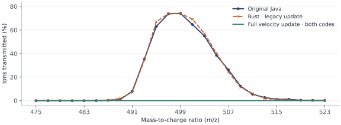

# MultiQ Workbench

A macOS research simulator for the MultiQ ion trap. Follow a single ion through a mass-selective channel, or track a shared population through two 486-quadrupole traps connected by nine channels. When a channel rejects an ion, the ion returns to the splitter with its position and velocity intact. It can encounter the same port again or reach a different one.

This is an independent implementation based on the [instrument and simulations reported by Krutchinsky and Chait](https://doi.org/10.1126/sciadv.aec7048). The workbench has been checked against the released code and digitized figures. Its predictions have not been validated against raw instrument scans or transients.

## Run on macOS

Install the Xcode Command Line Tools, stable Rust, and Node.js with npm. The app uses Tauri 2; the channel library requires Apple Metal. From the repository root:

```sh
cargo install tauri-cli --version '^2' --locked   # once
npm ci
npm run dev
```

| View | What to do |
| --- | --- |
| **Explore** | Adjust RF, excitation, gate voltage, or pressure. Pause and step through computed channel trajectories alongside the instrument reconstruction. |
| **Compare** | Inspect the simulated response alongside spectra digitized from the paper. |
| **Optimize** | Sweep operating settings and inspect transmission and leakage before applying a candidate to the simulator. |
| **Tandem** | Select **Run tandem** to launch a seeded pulse. The Fig. 5 reconstruction starts with four driven channels targeting ubiquitin 6+ through 9+. Save the run for per-port crossings, charge-state counts, and retries. |

## Numerical checks

**Can the model reproduce the original single-channel resonance?** Under the Fig. 4 simulation settings (100 V RF at 500 kHz, 0.5 V excitation at 100 kHz, 5 V DC, 1 mTorr), the original Java simulator and the Rust legacy calculation both transmitted **742 of 1,000 ions at m/z 499**. Their peak widths at half maximum were 12.09 and 12.23 m/z, respectively.



The [released trajectory code](https://github.com/akrutchins/Ion-Ejection-from-MultiQ/blob/279240a314978ea508aa43e60c8bd212b11321d8/TRAJECTORY.pde#L90-L97) computes the new velocity from the step’s average displacement, giving a velocity increment of ½aΔt. Changing only that update in Java, and only the corresponding force multiplier in Rust, gave **zero transmissions in each 25,000-ion scan** (m/z 475–523 in steps of two). This comparison isolates the numerical effect at those drive settings; it does not establish the transmission of the physical instrument. [Scan counts (CSV)](docs/mass-scan.csv)

**How stable is the predicted return fraction?** With the corrected desktop model, the same 1,000 m/z 499 launches were replayed on three independently solved field grids. Initial states, gas collision settings, random seeds, the 100 ns timestep, and loss surfaces stayed fixed.

| Field spacing | Returned to trap | Hit an electrode | Left simulation box |
| ---: | ---: | ---: | ---: |
| 0.100 mm | 175 | 808 | 17 |
| 0.050 mm | 196 | 787 | 17 |
| 0.0333 mm | 207 | 778 | 15 |

Most ions hit an electrode at every spacing. The return fraction still changes with resolution, so it should not be treated as a fixed probability for tandem design. [Paired counts (CSV)](docs/grid-counts.csv)

## Model scope and experimental data

The Rust transport model advances independent ions through RF and DC fields with thermal nitrogen collisions. Tandem uses the same clock across the splitter, channels, and combiner, but solves their fields separately. It omits space charge. The instrument rendering’s animated cloud illustrates the trap volume; the trajectory views show computed positions.

The [bundled reference data](data/research.json) contain digitized figure values, extraction notes, and checksums. Channel assignments and drive amplitudes in the four-channel reconstruction are model settings. The next experimental test is to compare predicted channel currents and arrival times with **raw scans and transients recorded with their operating settings and acquisition timing**.

## Tests and packaging

```sh
npm run build && npm test
cargo test --release --locked --manifest-path src-tauri/Cargo.toml -p multiq-desktop -p trapsim
npm run bundle
```

## Reference and attribution

Andrew N. Krutchinsky and Brian T. Chait. [“A nature-inspired ion trap for parallel manipulation of ions on a massive scale.”](https://doi.org/10.1126/sciadv.aec7048) *Science Advances* **12**, eaec7048 (2026).

The original [486Q trap](https://github.com/akrutchins/MultiQ) and [ion-ejection channel](https://github.com/akrutchins/Ion-Ejection-from-MultiQ) sketches by Andrew Krutchinsky are preserved in [reference/](reference/) with their BSD notices. Processing 4 is optional and is used only to open those sketches.
